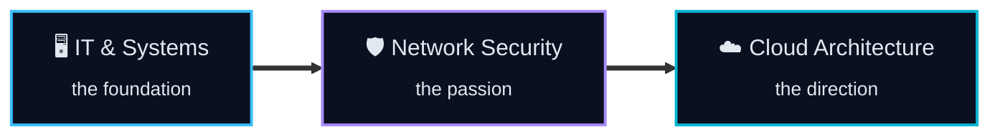

  <b>IT undergraduate @ SLIIT</b> · Sri Lanka 🇱🇰 
  Strong systems fundamentals · Passionate about network security · Building toward cloud architecture

  <a href="#-about">About</a> ·
  <a href="#-the-path">Path</a> ·
  <a href="#-projects">Projects</a> ·
  <a href="#-toolkit">Toolkit</a> ·
  <a href="#-roadmap">Roadmap</a> ·
  <a href="#-contact">Contact</a>

## 🧭 About

I like understanding how a system works from end to end: the machine, the network it sits on, and the cloud it eventually runs in.

- 🖥️ **My foundation** is IT and systems: Linux, troubleshooting, databases, virtualization.
- 🛡️ **My passion** is network security: firewalls, secure design, and threat analysis.
- ☁️ **My direction** is cloud architecture: designing infrastructure that is secure and scalable from day one.

## 🪜 The Path

## 🚀 Projects

<table>
<tr>
<td width="50%" valign="top">

### 🔥 Firewall & Threat Analysis Lab
**Status:** 🟡 In progress

Building secure virtual environments, configuring firewalls, and analyzing traffic to understand how real infrastructure is defended.

`Virtualization` `Firewalls` `Threat Analysis`

</td>
<td width="50%" valign="top">

### 🔁 [Automated Cisco Router Disaster Recovery](https://github.com/Dinuka24-coder/Automated-Cisco-Router-Disaster-Recovery-Plan-Project)
**Status:** 🟢 Published

Automating recovery for Cisco routers so network infrastructure can be restored quickly after a failure.

`Python` `Cisco` `Automation`

</td>
</tr>
</table>

## 🧰 Toolkit

| Area | Tools |
|:--|:--|
| 🖥️ **Systems** | `Linux` · `Bash` · `Git` · `Docker` |
| ☁️ **Cloud** | `AWS` · `Google Cloud` |
| 🛡️ **Networking & Security** | `Firewalls` · `Cisco` · `Virtual Labs` |
| 💻 **Development** | `Python` · `PHP` · `JavaScript` · `Node.js` · `Express` · `React Native` |
| 🗄️ **Data** | `MySQL` · `MongoDB` |
| 🎨 **Design & API** | `Figma` · `Postman` |

<b>🌱 Currently learning</b>

 

- Computer networking concepts
- Network security and infrastructure management courses
- Cloud platform fundamentals

## 🎯 Roadmap

- [x] Build an IT and systems foundation
- [x] Learn core networking concepts
- [x] Publish a network automation project
- [ ] Complete the Firewall & Threat Analysis Lab
- [ ] Earn a cloud certification (AWS or GCP)
- [ ] Design and deploy a secure cloud architecture
- [ ] Become a cloud architect ☁️

## 📬 Contact

  <a href="mailto:amarasekaradinuka25@gmail.com"><b>📧 Email</b></a> &nbsp;·&nbsp;
  <a href="https://www.linkedin.com/in/dinuka-amarasekara-8610272b6"><b>💼 LinkedIn</b></a> &nbsp;·&nbsp;
  <a href="https://instagram.com/hesh_7.0"><b>📸 Instagram</b></a>

<i>Good infrastructure is invisible until it's secure, reliable, and everything just works.</i>

