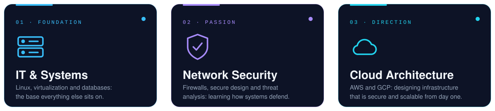
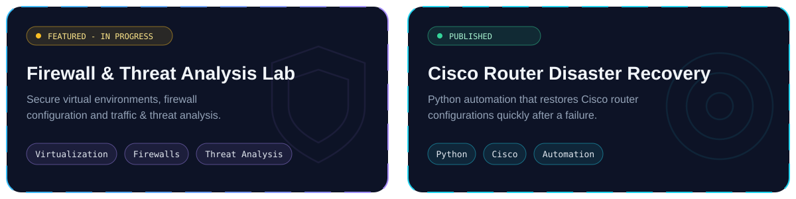

<b>IT & Systems</b> · <b>Network Security</b> · <b>Cloud Architecture</b>

Strong systems fundamentals, a passion for securing networks, and a direction toward designing the cloud.

  <a href="mailto:amarasekaradinuka25@gmail.com">Email</a> ·
  <a href="https://www.linkedin.com/in/dinuka-amarasekara-8610272b6">LinkedIn</a> ·
  <a href="https://instagram.com/hesh_7.0">Instagram</a>

✦ ───────────────────────────── ✦

## Who's behind the keyboard

<table width="100%">
<tr>
<td width="62%" valign="top">

I like understanding how a system works end to end: the machine, the network it sits on, and the cloud it eventually runs in. I started with IT and systems, fell for network security, and I'm now building toward designing cloud infrastructure that is secure from day one.

**Always:** learning, experimenting, breaking things in labs so they don't break in production.

</td>
<td width="38%" valign="top">

`QUICK FACTS`

🎓 IT undergraduate, **SLIIT** 
📍 **Sri Lanka** 
🔭 Building **FTAL** 
🌱 Learning **cloud + security** 
📫 Open to **collaboration**

</td>
</tr>
</table>

✦ ───────────────────────────── ✦

## Three layers, one direction

✦ ───────────────────────────── ✦

## The toolkit

✦ ───────────────────────────── ✦

## Built & building

  <a href="https://github.com/Dinuka24-coder/Automated-Cisco-Router-Disaster-Recovery-Plan-Project"><b>→ View the Cisco Router Disaster Recovery project</b></a>

✦ ───────────────────────────── ✦

## The road ahead

✦ ───────────────────────────── ✦

  <a href="mailto:amarasekaradinuka25@gmail.com"><b>📧 Email</b></a> &nbsp;·&nbsp;
  <a href="https://www.linkedin.com/in/dinuka-amarasekara-8610272b6"><b>💼 LinkedIn</b></a> &nbsp;·&nbsp;
  <a href="https://instagram.com/hesh_7.0"><b>📸 Instagram</b></a>

